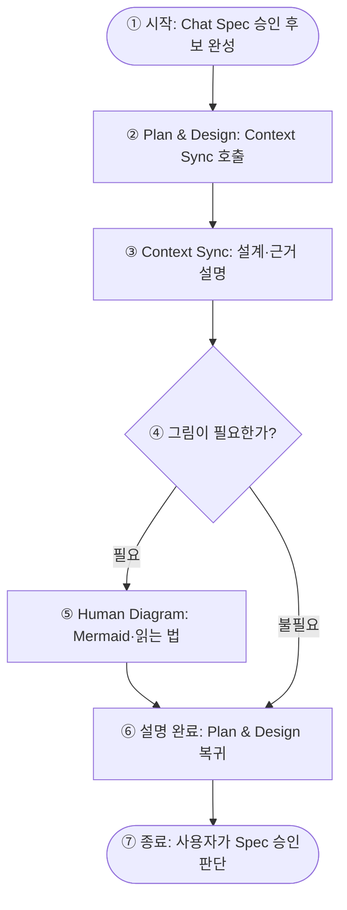

# Spec: Developer Context Sync & Human Diagram

- **기반 Intent:** [intent.md](intent.md)
- **관련 이슈:** [#163](https://github.com/taejung3852/OwnHands-Codex/issues/163)
- **기반 결정:** [ADR-0020](../../adr/0020-developer-context-sync-and-human-diagram.md), ADR-0017의 유지된 승인 경계
- **상태:** Approved v0.4 — v0.3 내용 승인 및 Human Diagram 가독성 보완 요청 반영
- **저장 승인:** 확정 — 2026-10-10
- **저장 대상:** `docs/specs/developer-context-sync/spec.md`
- **기존 검토 기준:** `work/163-developer-context-sync@2d4d5cc`
- **최종 수정 기준:** v0.3 전체 초안과 가독성 보완 합의. ADR-0020은 기존 작업 브랜치에서 다시 확인했다. 기존 검토 revision을 현재 HEAD로 재해석하지 않는다.

## 1. 목적과 책임 경계

사람이 AI 코딩 에이전트의 개발 맥락을 이해하고, 변경 이유와 검증 근거를 확인하며, 다음 판단을 내릴 수 있도록 지원한다.

세 Skill의 책임은 다음과 같이 분리한다.

| 구성요소 | 책임 | 하지 않는 일 |
|---|---|---|
| Chat `plan-design` | GORE 기반 Intent 작성, Spec 설계, 내용·저장 승인 | 맥락 설명 Skill에 요구사항 결정 위임 |
| `developer-context-sync` | 현재 개발 맥락·변경·판단 지점 설명 | 요구사항 결정, 구현, 승인 상태 변경 |
| `human-diagram` | 근거 기반 구조·흐름 Mermaid 표현 | 새로운 아키텍처 설계, 필수 렌더링 |

`developer-context-sync`와 `human-diagram`은 특정 SDLC Stage에 종속되지 않는 재사용 가능한 Skill이다.

## 2. 기능 요구사항

| ID | 요구사항 | Intent 목표 |
|---|---|---|
| REQ-01 | ONBOARD / CATCH-UP / DEEP-DIVE 제공 | G1 |
| REQ-02 | 질문 범위에 따라 관련 근거를 선택적으로 조회 | G1, G2 |
| REQ-03 | 구현·문서 의도·실행 근거·추론·미확인 구분 | G2 |
| REQ-04 | 비교 기준이 없는 변경 설명의 추정 금지 | G2 |
| REQ-05 | 경량 Mermaid Companion과 명확한 읽기 진입점 제공 | G1, G2 |
| REQ-06 | Chat `plan-design` 전용 설명 호출 정책 | G3 |
| REQ-07 | 설명 후 원래 작업 및 승인 상태 보존 | G3 |
| REQ-08 | Chat/Codex 공통 Skill 원본 유지 | G4 |
| REQ-09 | 활성 ELI5·Explain 경로 제거 | G1, G4 |
| REQ-10 | 배포 결과·호스트 실행·회귀 검증 | G2, G4 |

## 3. Developer Context Sync 입출력 계약

### 3.1 공통 입력

이는 Skill의 논리적 계약이다. 별도 JSON API, MCP 서버 또는 데이터베이스 구축을 의미하지 않는다.

| 필드 | 의미 |
|---|---|
| `mode` | ONBOARD / CATCH-UP / DEEP-DIVE |
| `target` | 저장소 또는 호출자가 전달한 문서 초안 |
| `question` | 사용자가 이해하려는 질문 |
| `scope` | 필요한 코드·문서·기능 범위 |
| `revision` | 실제 확인한 대상 버전 |
| `base_revision` | CATCH-UP 비교 기준 |
| `evidence` | 호출자가 확보한 코드·테스트·ADR·Diff 등 |
| `return_context` | 보조 호출 종료 후 복귀할 작업 맥락 |

사용자가 모든 필드를 직접 작성할 필요는 없다. 현재 대화와 접근 가능한 자료에서 확인한다.

확인되지 않은 필드는 임의로 만들어 채우지 않는다.

### 3.2 모드별 처리

| 모드 | 읽기 범위 | 출력 |
|---|---|---|
| ONBOARD | 이해에 필요한 주요 진입점, 책임, 흐름, 핵심 결정 | 목적 → 구조 → 현재 상태 → 제약 → 판단 지점 |
| CATCH-UP | 검증된 비교 기준과 현재 상태의 변경 및 영향 | 이전 → 현재 → 변경 이유 → 영향 → 위험·다음 작업 |
| DEEP-DIVE | 질문에 관련된 코드·문서·호출 흐름 | 질문에 대한 답 → 해당 구조 → 예외 → 근거·미확인 |

ONBOARD는 전체 저장소의 모든 파일을 읽는다는 의미가 아니다.

CATCH-UP에서 기준이 없다면 임의의 `HEAD~N`, 날짜 또는 사용자 checkpoint를 선택하지 않는다. 현재 상태 설명으로 제한한다.

DEEP-DIVE는 질문 범위를 넘어 불필요하게 아키텍처 전체를 재분석하지 않는다.

### 3.3 근거 처리

주요 설명에는 가능한 범위에서 파일·심볼·revision·ADR·실행 기록을 연결한다.

근거 상태는 다음과 같이 구분한다.

| 상태 | 의미 |
|---|---|
| 구현 관측 | 실제 코드를 읽고 확인한 동작·구조 |
| 문서화된 의도 | Intent·Spec·ADR 등에 기록된 결정 |
| 실행 관측 | 실제 실행·테스트에서 확인된 결과 |
| 추론·제안 | 확보한 근거에서 도출했지만 확인되지 않은 판단 |
| UNOBSERVED | 확인하지 못한 내용 |

문서에 적힌 설계가 구현됐다고 주장하거나, 테스트 파일이 존재한다는 이유만으로 테스트 성공을 선언하지 않는다.

Chat에서 접근할 수 없는 로컬 미커밋 변경은 UNOBSERVED로 표시한다. Codex에서도 실제 관측한 작업 트리만 근거로 사용한다.

### 3.4 출력 계약

출력에는 질문에 대한 핵심 답변, 설명 기준, 중요한 근거, 미확인 사항과 사람의 다음 판단이 포함돼야 한다.

짧은 질문에는 짧게 답한다. 모든 요청에 고정된 장문 보고서를 강제하지 않는다.

설명 결과는 기본적으로 대화에 반환한다. 자동으로 문서·체크포인트·코드·Git 상태를 변경하지 않는다.

## 4. Human Diagram 계약

### 4.1 기본 원칙

**한 그림은 하나의 질문과 하나의 추상화 수준만 다룬다. 독자가 어디부터 보고 어떤 방향으로 읽어야 하는지 알 수 있어야 한다.**

| 사용 목적 | 기본 표현 |
|---|---|
| 구성요소 책임·데이터 흐름 | `flowchart` |
| 호출 순서·재시도·비동기 처리 | `sequenceDiagram` |
| 상태 변화·승인·실패 전이 | `stateDiagram-v2` |
| 이전 구조와 변경 후 구조 비교 | `before-after` 비교 그림 |

표현은 목적에 맞는 최소 형식을 선택한다. Before/After는 별도의 Mermaid 문법이 아니라 동일한 추상화 수준의 변경 비교 표현이다.

구성요소의 관계와 실행 순서를 한 그림에 섞어 읽기 기준을 흐리지 않는다.

### 4.2 가독성과 근거

- 노드는 5~9개를 설계 목표로 하되 중요한 경계나 실패 경로를 삭제하지 않는다.
- 중요한 노드뿐 아니라 연결 관계에도 근거를 제공한다.
- 변경·미확인·제안은 색상에만 의존하지 않고 텍스트 표기로 구별한다.
- 호출자가 제공한 근거를 재사용한다. 부족한 경우 필요한 부분만 추가로 확인한다.
- 디렉터리 구조와 런타임 실행 구조를 혼동하지 않는다.

### 4.3 읽기 진입점과 진행 방향

그림을 제시할 때는 제목으로 답하려는 질문을 밝히고, 짧은 읽는 법으로 먼저 볼 곳과 읽는 방향을 안내한다. 실행 흐름도와 구성요소 관계도의 안내 방식은 구분한다.

| 규칙 | 실행 흐름도에 적용하는 방식 |
|---|---|
| 명확한 시작점 | `시작` 또는 해당 표기법의 시작 상태를 명시한다. 첫 사건이나 진입 조건을 함께 적는다. |
| 읽기 방향 통일 | 흐름도의 기본 방향은 위 → 아래다. 왼쪽 → 오른쪽이 더 적합하면 그 방향을 선택하고 읽는 법에 명시한다. |
| 주요 순서 표시 | 순차 실행의 주요 단계를 ①②③처럼 표시한다. 동시 처리나 구성요소 관계에 임의의 실행 순서를 부여하지 않는다. |
| 분기 조건 표시 | 분기 화살표에 `필요/불필요`, `성공/실패`처럼 실제 조건이나 결과를 명시한다. |
| 종료·복귀점 표시 | 흐름이 끝나는 지점 또는 원래 작업으로 돌아가는 지점을 명시한다. 복귀와 사용자 승인을 같은 사건으로 표시하지 않는다. |
| 여러 진입점 분리 | 독립된 진입 경로는 별도의 그림으로 설명한다. Chat과 Codex의 서로 다른 호출 정책을 한 실행 흐름에 섞지 않는다. |

표기법에 맞게 같은 목적을 달성한다. Sequence Diagram은 첫 호출과 위 → 아래의 메시지 순서, State Diagram은 초기·종료 상태와 전이 조건으로 읽기 기준을 제공한다.

**구성요소 관계도에는 실행 흐름의 시작·종료 노드나 단계 번호를 억지로 추가하지 않는다.** 제목과 읽는 법에서 먼저 볼 기준 구성요소를 지정하고, 연결이 호출·데이터·의존 중 무엇을 뜻하는지 안내한다.

예: “Developer Context Sync부터 보고, 연결된 Human Diagram과 근거 자료의 역할을 읽는다. 화살표는 구성요소의 의존 관계이며 실행 순서를 뜻하지 않는다.”

Before/After 비교는 같은 기준 구성요소와 추상화 수준을 사용하고, 어느 쪽이 이전·현재인지 텍스트로 표시한다.

### 4.4 출력 계약

기본 출력은 Markdown Mermaid, 짧은 읽는 법, 핵심 근거 및 텍스트 대체 설명이다. 읽는 법에는 그림 유형에 맞는 읽기 진입점과 방향을 포함한다.

텍스트만으로 충분한 경우 Mermaid를 생략한다.

HTML·SVG·PNG 생성, 브라우저 실행, `mmdc` 또는 외부 렌더러 설치는 기본 경로에 포함하지 않는다.

검증 상태는 **소스 점검 / 실제 렌더링 / 시각적 확인**으로 분리한다. 수행하지 않은 검증은 성공으로 표시하지 않는다.

### 4.5 가독성 계약 적용 예시

**그림의 질문: Chat에서 Spec 승인 전 설명이 정상 완료될 때, 어디서 시작해 어디로 돌아오는가?**

읽는 법: ① 시작에서 출발해 화살표를 위 → 아래로 따라간다. 그림이 불필요하면 ⑤를 건너뛰고 ⑥으로 이동한다.

텍스트 대체 설명: Chat에서 Spec 승인 후보가 완성되면 Plan & Design이 Context Sync를 호출한다. Context Sync는 설계를 설명하고 필요한 경우 Human Diagram의 그림을 사용한다. 설명을 마친 뒤 Plan & Design으로 돌아와 사용자가 Spec 내용 승인을 판단한다.

노드·연결의 근거: ②·③·⑥·⑦와 그 연결은 5절의 Chat 호출·복귀·승인 계약을, ④·⑤와 분기는 4절의 그림 선택·생략 계약을 표현한다.

이 그림은 목표 설계의 정상 경로 예시다. Skill 호출 실패는 5절의 Fallback 계약에 따른다. 예시의 존재는 신규 Skill 실행 성공이나 Mermaid 렌더링·시각적 확인의 증거가 아니다.

## 5. Chat plan-design의 설명 호출 경계

이 절은 Plan & Design과 Context Sync를 결합하는 아키텍처가 아니라 **호출자 측 정책**이다.

### Intent Stage — 선택 호출

Chat `plan-design`은 GORE 기반으로 문제, 목표, 요구사항, 성공 기준, 비목표를 정리한다.

Intent 검토는 기본적으로 `plan-design`이 직접 수행하며, 사용자가 원할 때 Context Sync를 보조 호출할 수 있다.

### Spec Stage — 승인 전 자동 1회

Chat `plan-design`에서 Spec 전체가 검토 가능한 승인 후보로 완성되면 다음 계약을 적용한다.

1. 현재 승인 후보를 설명 대상으로 식별한다.
2. Context Sync를 자동으로 1회 요청한다.
3. 주요 구성요소·제어 흐름·실패 경로·검증 기준을 설명한다.
4. 필요하면 Human Diagram을 사용한다.
5. 원래 `plan-design`으로 복귀하여 사용자 Content Approval을 요청한다.

동일 승인 후보에 대한 자동 중복 호출을 방지한다.

승인에 영향을 줄 만큼 Spec이 변경되어 새로운 검토 주기가 시작되면 수정된 후보를 다시 설명한다. 단순 문구 수정으로 전체 설명을 반복하지 않는다.

해당 중복 방지는 대화 내 작업 상태를 기반으로 설계하며 별도 영속 상태 관리 Runtime을 추가하지 않는다.

### Codex 적용 경계

**위 Intent·Spec 자동 호출 정책은 Codex에 적용하지 않는다.**

Codex는 두 Skill을 독립적으로 사용할 수 있으며, Context Sync 직접 호출이나 다른 작업 중 필요한 보조 호출을 허용한다. 이로 인해 Codex에 Chat의 GORE 인터뷰·Stage 승인 절차를 강제하지 않는다.

### 호출 불가 처리

Chat에서 실제 Skill 호출이 지원되지 않거나 실패하면 성공으로 표시하지 않는다.

`plan-design`이 필요한 범위의 경량 인라인 설명을 제공하는 Fallback을 적용한다. 이 결과는 Context Sync 호출 성공과 구분한다.

기존 Content Approval과 Persistence Decision은 독립적으로 유지한다. 설명 자체가 승인으로 처리되지는 않는다.

## 6. Chat/Codex 배포 설계

### 6.1 Canonical Source

확정된 기준 원본은 다음과 같다.

- `plugins/ownhands/skills/developer-context-sync/`
- `plugins/ownhands/skills/human-diagram/`

각 Skill의 기준 원본에는 `SKILL.md`, 필요한 `references/`, 지원 호스트의 metadata를 둔다.

### 6.2 Codex 동기화

Codex에는 다음 설치용 사본을 제공한다.

- `.agents/skills/developer-context-sync/`
- `.agents/skills/human-diagram/`

동기화 계약은 다음과 같다.

- 기준 원본에서 Codex 배포용 파일을 생성한다.
- `SKILL.md`와 References는 원본과 바이트 단위로 일치해야 한다.
- `--check`는 읽기 전용으로 원본·사본 일치를 검사한다.
- `--write`는 개발자가 명시적으로 실행할 때만 배포용 사본을 갱신한다.
- 파일 누락·내용 불일치가 있으면 패키징 검증에 실패한다.
- 배포용 파일은 Symlink가 아닌 실제 파일이어야 한다.

동기화 도구의 후보 경로는 `scripts/sync-shared-skills.js`다.

이는 개발·패키징용 도구이며 사용자 요청마다 자동 실행하는 Runtime이 아니다.

### 6.3 기대 배포 구성

| Chat Plugin | Codex npm |
|---|---|
| `plan-design` | `build` |
| `developer-context-sync` | `verify` |
| `human-diagram` | `review` |
| | `feedback` |
| | `write-issue-pr` |
| | `developer-context-sync` |
| | `human-diagram` |

Chat은 3개, Codex는 7개 Skill을 제공하는 구성이 목표다.

Codex에는 `plan-design`을 설치하지 않는다. Chat Plugin 전체도 npm 패키지에 포함하지 않는다.

Host metadata 선언과 실제 호스트 호출 가능성은 별도로 검증한다.

## 7. 기존 설치 처리

### 확정 정책

**#163에서는 자동 마이그레이션을 구현하지 않는다.**

신규 설치가 새 Skill 구성을 제공하도록 수정하며, 기존 설치에서 새 구성을 적용하는 과정은 수동 가이드로 제공한다.

기존 CLI의 충돌 방지 정책을 유지한다.

수동 이전 가이드에는 다음 안전 조건이 포함돼야 한다.

1. 기존 설치 manifest와 사용자 변경 여부를 먼저 확인한다.
2. 제거가 필요한 기존 OwnHands-owned 파일은 manifest의 해시와 일치하는지 확인한다.
3. 사용자 수정 파일과 global Skill은 삭제하거나 덮어쓰지 않는다.
4. 기존 `AGENTS.md`의 사용자 내용과 타사 Hook 설정을 보존한다.
5. 이전 뒤 설치 manifest와 실제 자산을 검사한다.

자동 업데이트·자동 uninstall 명령은 추가하지 않는다.

## 8. 변경 범위

### 신규 후보

두 Skill과 최소 References, Codex 배포 사본, 동기화·일치 검사 자산, #163 Intent 및 Spec.

### 수정 후보

Chat `plan-design`의 활성 ELI5 지침, Plugin metadata 및 안내, npm 설치·패키징 문서, 루트 README, 기존 Chat Plan & Design Spec의 현재 유효 계약, 관련 정적 테스트와 Eval.

Human Diagram의 읽기 진입점·진행 방향 규칙과 실행 흐름도·관계도 가독성 시나리오를 Skill, 최소 References 및 해당 검증 자산에 반영한다.

### 제거

OwnHands 배포물의 ELI5, 활성 Codex `explain` Skill 및 해당 호출 연결.

과거 ADR·회고·검증 기록은 보존하며 기존 결정이 부분 대체된 사실을 명시한다.

Build·Test 자체 재설계(#162), Reviewer·Hook·Gate 재설계, 외부 렌더러·새 MCP 서버·자동 마이그레이션은 범위에서 제외한다.

## 9. 수용 기준 및 검증 전략

| AC | 기대 결과 | 검증 |
|---|---|---|
| AC-01 | ONBOARD가 목적·구조·현재 상태를 설명 | 대표 시나리오 실행 |
| AC-02 | CATCH-UP이 검증된 기준으로 변경을 설명 | 두 revision 비교 |
| AC-03 | 비교 기준 없이 가짜 변경 이력을 생성하지 않음 | 기준 누락 시나리오 |
| AC-04 | DEEP-DIVE가 관련 질문 범위만 설명 | 특정 기능 사례 |
| AC-05 | 문서 의도·구현·실행·추론·미확인을 구분 | 근거 충돌 사례 |
| AC-06 | Mermaid가 필요한 경우에만 선택됨 | 구조 질문 및 단순 질문 |
| AC-07 | Mermaid 요소와 근거가 연결되고 검증 상태가 구분됨 | 소스·렌더링 별도 점검 |
| AC-08 | Chat Intent는 선택 호출, Spec은 승인 전 자동 1회 | Chat E2E |
| AC-09 | Codex에 Chat 전용 자동 호출 규칙이 적용되지 않음 | Codex 호출 시나리오 |
| AC-10 | 설명 후 원래 작업과 승인 상태 보존 | Plan & Design 회귀 |
| AC-11 | Canonical·Codex 사본 일치 | 동기화 `--check` |
| AC-12 | Chat 3개, Codex 7개 Skill 구성 및 기존 활성 자산 제거 | 패키징·정적 검사 |
| AC-13 | 기존 사용자 설치·global 파일 무단 변경 방지 | 설치 충돌·수동 이전 검사 |
| AC-14 | 실행 흐름도의 시작·읽기 방향·주요 단계 순서·분기 조건·종료 또는 복귀점을 식별할 수 있음 | 정상 흐름과 그림 생략 분기의 소스 점검 및 읽기 시연 |
| AC-15 | 관계도는 기준 구성요소와 연결 의미를 안내하고, 독립된 진입 경로는 별도의 그림으로 설명함 | 관계도와 Chat/Codex 독립 흐름 사례 검토. 가짜 시작·종료·실행 순서가 없는지 확인 |

AC-14·AC-15는 REQ-05와 Intent G1·G2를 구체화한다. 표기만 확인하는 정적 검사와 사람이 실제로 읽기 쉬운지 확인하는 시연·피드백을 구분한다.

검증 대상 명령:

- `node --test tests/ownhands-plugin.test.js`
- `node --test tests/ownhands-cli.test.js`
- `npm test`
- `npm pack --dry-run --json`
- 동기화 검사 명령 및 대표 호스트별 E2E

기존 Eval의 `explain` 시나리오와 ELI5 관련 검사도 새로운 계약에 맞게 갱신한다. 과거 실행 기록을 새로운 테스트 성공 기록으로 고쳐 쓰지 않는다.

가독성 검증에는 시작·분기·복귀가 있는 흐름도, 실행 순서가 없는 관계도, 독립된 진입 경로를 분리한 사례를 포함한다. 각 사례에서 제목·읽는 법·주요 근거가 함께 제공되는지 확인한다. 외부 렌더러 설치를 수용 조건으로 추가하지 않는다.

정적 검사가 통과해도 Chat·Codex에서 실제 Skill 호출이 성공했음을 의미하지 않는다.

실행하지 않은 검사는 `UNOBSERVED`로 표시한다.

## 10. 완료 조건

#163은 두 신규 Skill의 설명 책임, 호출 정책, 배포 원본, 안전한 설치 경계 및 수용 기준이 승인된 Spec에 맞게 구현되고 검증됐을 때 완료 대상으로 판단한다.

Human Diagram의 가독성은 4절의 읽기 진입점·방향 계약과 AC-14·AC-15를 통해 확인한다.

Spec 승인·GitHub 저장은 Build 실행, PR 생성 또는 Merge 승인을 포함하지 않는다.
